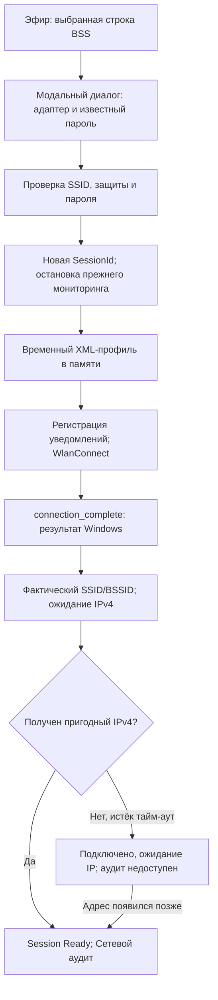

# Milestone 5 — подключение к Wi-Fi и Network Session

Дата проверки: 14 октября 2026 года. Расширен существующий solution; оформление Light_Interface и ранее выполненный рефакторинг сохранены. Новые NuGet-пакеты не добавлены. Функционал включён в [Version 7 (7.0.0)](https://github.com/KirillBass/WIFI_Scanner/releases/tag/v7.0.0), подготовленный 14 октября 2026 года. Архив Light_Interface относится к предыдущей версии.

## 1. Новые и изменённые файлы

Новые файлы относительно состояния проекта перед данным этапом:

| Слой | Файлы | Назначение |
| --- | --- | --- |
| Core/Interfaces | `IWifiConnectionService.cs`, `INetworkSessionService.cs` | Асинхронные операции подключения и общий контекст сети |
| Core/Models | `WifiConnection.cs`, `NetworkSession.cs` | Запрос, результат, состояния/ошибки, фактическое соединение, immutable сессия |
| Core/Network | `NetworkSessionService.cs`, `WifiConnectionPolicy.cs` | Версии/границы сессии, поддерживаемые типы защиты и сообщения |
| Infrastructure.Windows/Wifi | `WifiProfileBuilder.cs`, `WifiConnectionOptions.cs`, `IWifiConnectionBackend.cs`, `NativeWifiConnectionBackend.cs`, `WindowsWifiConnectionService.cs` | XML, тайм-ауты/координатор, подменяемая граница Windows API и orchestration |
| Infrastructure.Windows/NativeWifi | `NativeWifiConnection.cs`, `WlanConnectionStructs.cs` | Partial существующего NativeWifiClient, ожидание уведомлений, ABI |
| App/ViewModels | `NetworkSessionViewModel.cs`, `WifiConnectionDialogViewModel.cs`, `NetworkAuditViewModel.cs` | Общая UI-проекция, модальный диалог, контекст аудита |
| App/Views | `WifiConnectionDialog.axaml` и `.axaml.cs`, `NetworkAuditView.axaml` и `.axaml.cs` | Диалог и страница аудита |
| docs | `WIFI_CONNECTION_REPORT.md` | Этот отчёт |

Изменены существующие файлы:

- `Core/Models/WifiAccessPoint.cs`, `NativeWifi/BssMapper.cs`: сохранение исходных байтов SSID.
- `NativeWifi/NativeWifiClient.cs`, `NativeWifiMethods.cs`: общая безопасная регистрация callback, dispatch connection notifications, P/Invoke Connect/Disconnect/QueryInterface. Прежний путь сканирования сохранён.
- `Wifi/WindowsWifiScanner.cs`: общий gate со службой подключения, исключающий одновременные WLAN scan/connect операции.
- `Core/Interfaces/IDeviceMonitorService.cs`, `Core/Network/DeviceStateTracker.cs`, `Network/DeviceMonitorService.cs`: ResetAsync останавливает discovery/enrichment и очищает историю, сохраняя монотонную версию snapshot.
- `Network/Identity/DeviceIdentityCache.cs`: явная очистка при смене сессии.
- `App.axaml`, `App.axaml.cs`: шаблон страницы и singleton-регистрации DI.
- `AccessPointsViewModel.cs`, `AccessPointsView.axaml`: выбор сети, доступность кнопки подключения и объяснение неподдерживаемой защиты.
- `DashboardViewModel.cs`, `DashboardView.axaml`: текущее соединение.
- `DevicesViewModel.cs`: выбор сети общей сессии, очистка прежних строк, блокировка discovery до IPv4.
- `MainWindowViewModel.cs`, `MainWindow.axaml`, `MainWindow.axaml.cs`: седьмая вкладка, постоянный статус, модальный диалог, переход после Ready, асинхронный shutdown.
- `README.md`, `docs/IMPLEMENTATION_STATUS.md`: использование и статус реализации.

Ранее выполненные изменения общих ViewModel, графиков и укрупнение небольших моделей относятся к предшествующему рефакторингу. Они сохранены; их регрессионные проверки входят в общий прогон. Локальные тесты и демонстрационный стенд находятся за пределами Git-репозитория, как ранее просил пользователь.

## 2. WlanConnect flow

Сервис проверяет запрос до изменения сессии и до обращения к WLAN. Локальный gate отклоняет повторное Connect/Disconnect; общий координатор сериализует сканер и connector. Подключение выполняется к SSID, без обязательного desired-BSSID: Windows вправе выбрать другую BSS этого SSID. В сессию записывается фактический BSSID из WlanQueryInterface. Нативные вызовы выполняются вне UI-потока.

Возврат WlanConnect означает запуск операции, окончание определяется уведомлением. Это соответствует [документации WlanConnect](https://learn.microsoft.com/en-us/windows/win32/api/wlanapi/nf-wlanapi-wlanconnect).

## 3. Профили Open и WPA2-Personal

`WifiProfileBuilder` использует XElement и namespace WLAN profile v1. Профили имеют случайное несекретное имя, тип ESS и ручное подключение. SSID кодируется исходными байтами в hex; строковое имя добавляется только при допустимых XML-символах. Спецсимволы экранируются средствами XML-библиотеки.

Open: authentication=open, encryption=none, useOneX=false, sharedKey отсутствует. WPA2-Personal: WPA2PSK/AES, useOneX=false, sharedKey с passPhrase либо networkKey. Поддерживается 8–63 печатных ASCII-символа или PSK из 64 hex-символов. Unicode SSID допускается; Unicode passphrase отклоняется с объяснением, поскольку Windows profile schema ограничивает WPA/WPA2 passphrase ASCII. См. [sharedKey в схеме Windows](https://learn.microsoft.com/en-us/windows/win32/nativewifi/wlan-profileschema-sharedkey-security-element).

Проверка WPA2-Personal требует CCMP в списке Pairwise и допускает групповой CCMP либо TKIP. Вариант `Pairwise: TKIP, CCMP; Group: TKIP` разрешён: XML по-прежнему запрашивает WPA2PSK/AES, автоматического fallback на TKIP для клиента нет. Групповой шифр отображается отдельно и не выдаётся за AES. Пара authentication/encryption задаётся по [схеме authEncryption Windows](https://learn.microsoft.com/en-us/windows/win32/nativewifi/wlan-profileschema-authencryption-security-element).

В WlanConnect передаётся `wlan_connection_mode_temporary_profile`. WlanSetProfile/сохранение профиля/удаление пользовательских профилей не используются.

## 4. Защита пароля

Пароль отображается маской; поле очищается сразу при запуске операции и повторно в finally/при закрытии. Запрос — обычный класс с безопасным ToString, без генерируемого record-ToString с полем Password. Credentials исключены из NetworkSession, результатов, конфигурации и сообщений исключений. Сервис пишет только тип ошибки и код, без объекта исходного исключения или XML.

XML живёт только при запуске нативного подключения; ссылки освобождаются в finally. Неуправляемая Unicode-копия обнуляется через ZeroFreeGlobalAllocUnicode. Строки .NET неизменяемы: гарантированное обнуление всех управляемых копий/внутренних буферов Windows не обещается. Приложение минимизирует время их жизни и не сохраняет пароль на диск.

## 5. Native Wi-Fi notifications

Callback удерживается полем NativeWifiClient до снятия регистрации и закрытия handle. Проверяются source ACM, interface GUID, размер фиксированного заголовка, SSID и имя временного профиля. Хвост notification с XML не читается и не журналируется.

- connection_start: состояние Authenticating.
- connection_attempt_fail: сохраняется reason code; это промежуточная попытка, Task не завершается.
- connection_complete: reason=0 означает успех, иначе возвращается типизированная ошибка. Ранее полученный код аутентификации сохраняется, если финальный код сообщает отсутствие доступной сети.
- interface_removal: понятная ошибка отсутствующего/отключённого адаптера.
- network_not_available: сеть недоступна на данном интерфейсе.
- disconnected: завершает ожидающий Disconnect.

Ожидание основано на TaskCompletionSource и WaitAsync с отменой/тайм-аутом; фиксированной задержки для угадывания association нет. Промежуточные попытки и финальное уведомление различаются согласно [описанию WLAN notifications](https://learn.microsoft.com/en-us/previous-versions/windows/desktop/legacy/ms706902(v=vs.85)).

## 6. Ожидание DHCP/IPv4

После association состояние ObtainingAddress. Используется прежний ILocalNetworkService / WindowsLocalNetworkService: выбирается пригодный IPv4 именно Wi-Fi интерфейса подключения по GUID. Маска/подсеть вычисляются прежним SubnetCalculator; APIPA, loopback и невалидные адреса прежним сервисом отфильтровываются. Отсутствующий шлюз допустим для локальной сети и показывается как «—»; интернет-доступ не проверяется.

Параметры WifiConnectionOptions: association 25 секунд, IPv4 18 секунд, Disconnect 8 секунд, опрос адреса 500 мс. Отдельный связанный CancellationToken ограничивает также ожидающие сетевые операции. При истечении IPv4-тайм-аута Wi-Fi остаётся подключённым, Ready=false. Фоновое обновление сессии раз в 2 секунды замечает адрес, появившийся позднее. Пока диалог открыт и принадлежит этому соединению, Ready закрывает его и открывает аудит.

## 7. NetworkSessionService

Singleton в DI — единственный источник текущего SSID/BSSID/интерфейса/IPv4/префикса/подсети/шлюза/защиты/ConnectedAt. Immutable snapshot имеет SessionId и возрастающую Version; UI читает одну NetworkSessionViewModel, обновляемую через Avalonia Dispatcher. Старые версии и результаты с чужим expectedSessionId игнорируются.

Новая попытка подключения создаёт новый SessionId. Изменение SSID, GUID интерфейса, IPv4/префикса/шлюза либо потеря адреса также меняют контекст. Другая сеть с тем же IPv4/подсетью различается по SSID и новой сессии. Роуминг между BSSID одного SSID при сохранённом сетевом контексте обновляет BSSID без сброса истории. При смене сети служба сначала останавливает signal/device monitoring и identity worker, очищает DeviceStateTracker и DeviceIdentityCache. Это исключает повторное использование прежних имён и устройств в новой сети.

При старте читается уже установленное соединение Windows; последующее внешнее переключение/исчезновение сети обнаруживается опросом с интервалом 2 секунды. Быстрое отключение и повторное подключение между двумя опросами может остаться незамеченным. Приложение не трактует неизвестные сведения о group cipher/PMF как подтверждённые; выбранная защита BSS и фактически известные Windows параметры различаются.

## 8. Навигация после подключения

В «Эфире» кнопка доступна для выбранной поддерживаемой сети; Enterprise и другие неподдерживаемые типы имеют пояснение. Модальный Window используется только для подключения; основное приложение остаётся одним окном.

После успешного результата Ready диалог закрывается и MainWindowViewModel выбирает «Сетевой аудит». До IPv4 автоматического перехода нет. Там показаны сетевой контекст, счётчик текущих устройств и кнопки обновления/отключения. «Устройства» остаётся доступной отдельной вкладкой и использует прежнее обнаружение. Сохранены светлое оформление и вкладки сверху; постоянный статус размещён в нижней строке вместо sidebar из более раннего макета ТЗ.

## 9. Disconnect и shutdown

Disconnect переводит сессию в Disconnecting, останавливает операции и вызывает WlanDisconnect. Уведомление disconnected подтверждает завершение; при тайм-ауте дополнительно проверяется фактическое отсутствие association. Сессия, список устройств и identity cache очищаются. Постоянные Windows-профили пользователя не удаляются.

Отмена pending association вызывает best-effort WlanDisconnect. Отмена пользователем во время ожидания IPv4 также отключает уже установленное соединение. При shutdown pending tasks/мониторинг отменяются и ожидаются; соединение, уже успешно установленное к этому моменту, автоматически не отключается. После завершения задач DI освобождает нативный handle и callback.

## 10. dotnet restore / build

Выполнены dotnet restore и Release build существующего WirelessSecurityAnalyzer.sln. Результат: 0 ошибок, 0 предупреждений. Новых пакетов и проектов solution нет. Отдельно собран локальный GUI-стенд; production startup/DI проверен в Linux.

Создана актуальная self-contained публикация Windows x64 через профиль WindowsX64 с locked dependencies: `publish/win-x64/` (236 файлов), `publish/WirelessSecurityAnalyzer-win-x64.zip` и `.sha256`. Архив проверен по CRC и SHA-256 каждого файла на совпадение с папкой приложения. Проверены Windows x64 PE executable, наличие runtime и типов нового функционала в сборках. Устаревшие версии и дубликаты удалены из `publish/`; архив распространяется в релизе Version 7 (`v7.0.0`).

## 11. dotnet test

Локальные тесты выполняются через отдельный WirelessSecurityAnalyzer.LocalTests.sln вне репозитория, включая прежние наборы Milestones 1–4 и refactoring regression. На текущем прогоне: **518 passed, 0 failed, 2 skipped** (Core 207, Windows/UI 311). Две существующие аппаратные проверки — WLAN scan и Windows neighbor table — требуют Windows и реальных адаптеров.

Новые сценарии: Open/WPA2 XML/escaping/Unicode SSID/raw PSK/границы и ошибки пароля/неподдерживаемые типы, session readiness/новый контекст/stale update/роуминг, notification correlation/intermediate failure/reason mapping/ABI, success/fail/cancel/Busy/connection deadline/DHCP deadline/зависший local-network lookup/поздний IPv4/Disconnect/shutdown/external switch, отсутствие секрета в логах, реальный сброс активного discovery, маскировка/очистка UI, повтор после ошибки, семь страниц и автоматическая навигация после модального подключения.

После исправления проверки группового TKIP добавлены 8 регрессионных случаев: разбор RSN с Pairwise TKIP+CCMP и Group TKIP, XML с AES, независимость группового шифра от CCMP для клиента, отказ для неподдерживаемого group cipher, проход запроса к backend и активная кнопка «Подключиться» в реальном Avalonia View при уже установленном соединении. Проверки аппаратного подключения к этому роутеру в Linux не выполнялись.

Сам production solution намеренно не содержит тестовых проектов; успешный dotnet test для него не заменяет приведённый локальный тестовый прогон.

## 12. Ручная проверка

Проверены production startup/DI, сообщение UnsupportedPlatform на Linux, новая вкладка и строка статуса. Отдельный локальный стенд использует реальные Avalonia Views/ViewModels и WindowsWifiConnectionService, подменяя только нативное соединение и сетевой контекст. В GUI проверены Open без поля пароля; WPA2 с маскировкой, неверным паролем и успешным вводом; отмена; отключение; прежний discovery после подключения; переход Open → WPA2 на том же IPv4; позднее получение адреса и автоматический переход в аудит; понятная ошибка при имитации исчезновения адаптера. Очистка прежней истории и кэша при смене контекста дополнительно проверена локально. На стенде используются сокращённые тайм-ауты и искусственные ответы backend. Журналы проверены на отсутствие тестовых паролей, keyMaterial и XML-профиля. Переход в аудит синхронизирует актуальную сессию и выполняется через Dispatcher после обработки закрытия модального окна.

Реальные WlanConnect/WlanDisconnect, DHCP роутера, аппаратное извлечение USB-адаптера, политики Windows и реальные WPA2 credentials в Linux не проверены. Для приёмки необходим повтор этих сценариев на Windows 10/11; локальный backend-стенд не является аппаратной проверкой.

## 13. Ограничения типов сетей и этапа

Подключаются Open и WPA2-Personal AES/CCMP. Пока не подключаются WPA3-SAE, WPA2/WPA3 transition, WPA-Personal, WPA/TKIP, WEP, OWE, Enterprise/802.1X/EAP, ad-hoc и скрытые SSID без известного имени. Отображение прежних метаданных этих сетей в «Эфире» сохранено. Unicode WPA2 passphrase отклоняется согласно схеме Windows; Unicode SSID поддерживается.

IPv6-аудит, captive portal, сохранение credentials, pinning к BSSID, port/service scan, Nmap/pcap/monitor mode и изменения параметров роутера не добавлялись. DNS/identity/discovery используют ранее существующие локальные методы.
